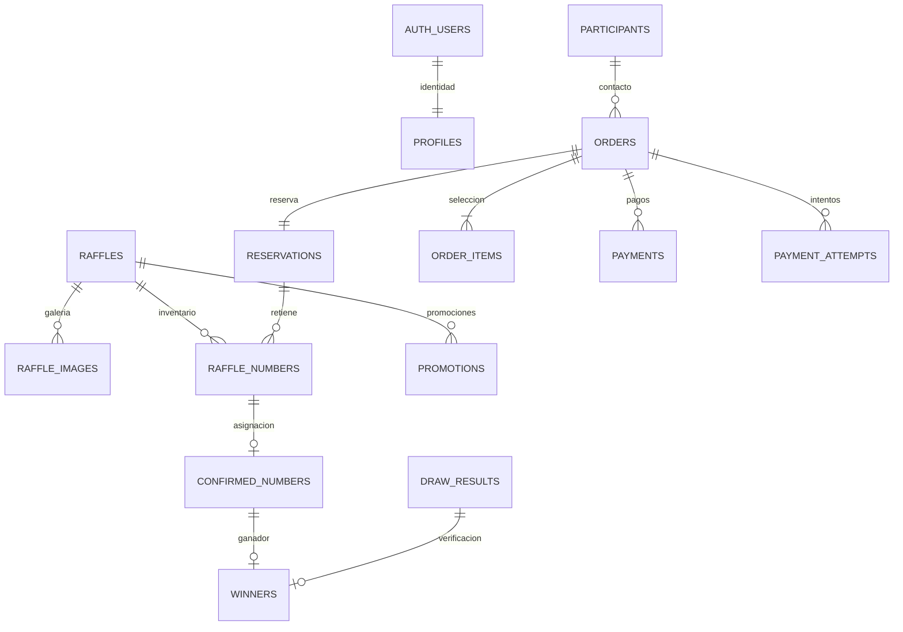

# Supabase: esquema, seguridad y configuración

Estado al 12/10/2026: proyecto Supabase `A fondo UY` (`tfpvrgtmmwqriwcedqlm`, organización NOVA Studio, región `us-west-2`) conectado al entorno local. Con autorización del usuario, se eliminó el esquema anterior incompatible y sus datos de prueba, y se aplicaron las siete migraciones versionadas. RLS está activado en las 24 tablas de negocio. Hay un sorteo `[DEMO]` con 200 números UYU y packs de prueba; no hay Auth users. Los pagos reales siguen deshabilitados.

La región actual es `us-west-2`; no se recreó el proyecto porque la herramienta de costos no está disponible. La URL y clave publicable se guardaron en `.env.local` (ignorado por Git). `SUPABASE_SERVICE_ROLE_KEY` permanece vacío y `RESERVATIONS_ENABLED=false`; para activar reservas en backend hace falta configurar esa clave como secreto de servidor.

## Modelo y relaciones

| Entidad | Implementación / responsabilidad |
| --- | --- |
| `profiles` | Una fila por `auth.users.id`; `viewer`, `admin`, `owner`, activo/inactivo. Fuente única de autorización |
| `raffles` | Premio, descripción, bases, estado, fecha, moneda, precio, cantidad y plazo de reserva; `is_demo` identifica fixtures |
| `raffle_images` | Galería ordenada, texto alternativo, objeto de Storage y publicación selectiva |
| `raffle_numbers` | Inventario canónico; PK `(raffle_id, number)`, estado y dueño de la reserva |
| `participants` | Nombre, correo y teléfono privados. No se recopilan cédulas ni datos de tarjeta |
| `reservations` | Plazo y estado; una por pedido |
| `reservation_numbers` | Vista privada `security_invoker`: reserva → pedido → ítems. Sin segunda lista que pueda divergir |
| `orders` | Participante, precios guardados, idempotencia, sesión invitada, vencimiento y estado |
| `order_items` | Número adquirido y precio unitario; FK compuestas impiden mezclar sorteos |
| `payments` | Referencia única del procesador, importe, moneda, estado verificado y modo |
| `promotions` | Packs configurables, precio, vigencia y habilitación |
| `winners` | Enlace privado entre resultado y número confirmado; identidad derivada de la confirmación, no duplicada |
| `draw_results` | Número ganador, fecha, evidencia y publicación. Un resultado nuevo exige confirmación previa |
| `public_results` | Vista `security_invoker` de resultados publicables; no contiene identidad, contacto ni pedido |
| `audit_events` / `audit_logs` | Tabla existente y vista privada normalizada, con actor, acción, entidad, fecha y detalle de cambios de rol |
| `webhook_events` | Identificador único, estado, intentos, lease y token de posesión para evitar trabajadores duplicados |
| `confirmed_numbers` | Asignación única e inmutable de número/sorteo a pedido y participante |
| `payment_attempts`, `payment_checks`, `reconciliation_cases` | Intentos previos a llamadas externas, verificación antes de liberar y conciliaciones |
| `number_availability` | Proyección pública exclusivamente para disponibilidad/Realtime; no contiene reservas ni compradores |
| `number_blocks`, `reservation_limits` | Bloqueos auditados y cuota de reservas por sesión |
| `admin_users` | Legado conservado sin borrado. Sus miembros se migran a `profiles`; ya no otorga permisos |



La PK de números y confirmaciones es compuesta por sorteo y número. Distintos sorteos pueden usar `001` sin compartir inventario. No se redefine el modelo mediante vistas con privilegios del propietario: las vistas de lectura usan `security_invoker`.

## Matriz de permisos RLS

Todas las tablas de negocio tienen RLS. Los grants limitan además las operaciones disponibles, incluso cuando una clave de servicio puede omitir RLS.

| Datos / operación | Anónimo | Cuenta común | Admin activo | Owner activo | Servidor |
| --- | --- | --- | --- | --- | --- |
| Sorteos, números y promociones | Solo publicados / vigentes | Igual | Lectura de gestión | Igual | Lectura |
| `number_availability` | Solo sorteos publicados | Igual | Igual | Igual | Lectura; trigger actualiza |
| `profiles` | Sin acceso | Solo propio, lectura | Lectura | Lectura | Lectura |
| Asignar roles | No | No | No | RPC con validación | Bootstrap inicial restringido |
| Participantes, pedidos, reservas, pagos | Sin acceso | Sin filas | Lectura | Lectura | Lectura y RPC privadas |
| Confirmaciones, ganadores y auditoría | Sin acceso | Sin filas | Lectura | Lectura | Lectura |
| Imágenes / objetos Storage | Solo publicados de sorteos publicados | Igual | Gestión autorizada | Igual | Según función / Storage |
| Reservar, confirmar, liberar | No directo | No directo | No directo | No directo | RPC transaccionales |
| Webhooks y conciliación | Sin acceso | Sin filas | Lectura | Lectura | Funciones privadas verificadas |

No hay políticas públicas de inserción ni actualización de compras. También se revocan escrituras directas de `service_role` sobre el inventario, pedidos, participantes, promociones, pagos, auditoría y eventos: el backend usa funciones `SECURITY DEFINER` con `search_path` vacío, parámetros validados y ejecución restringida. Los administradores operan funciones que consultan su rol real en PostgreSQL. Cambiar metadata o conservar un JWT viejo no conserva permisos revocados.

## Migraciones e impacto

Aplicar en orden:

1. `202610090001_initial_schema.sql`: base inicial, integridad, RLS y Storage privado.
2. `202610110001_reservations.sql`: reservas, cotizaciones, expiraciones, confirmaciones y conciliación.
3. `202610110002_admin_inventory.sql`: operaciones administrativas auditadas.
4. `202610110003_supabase_foundation.sql`: perfiles, galería, ganadores, vistas, eventos y reducción de grants.
5. `202610110004_payment_sandbox.sql`: trazabilidad de pagos y recibos seguros.
6. `202610110005_admin_dashboard.sql`: configuración, resultados y métricas administrativas.
7. `202610110006_participation_transparency.sql`: notificaciones, comprobantes y transparencia.

En el proyecto conectado también se registraron las migraciones operativas `legacy_public_schema_cleanup` y `revoke_anon_is_admin_execute`. La segunda revoca al rol `anon` la llamada al predicado administrativo; la migración inicial local ahora incluye esa revocación para instalaciones nuevas.

Para una base nueva, aplicar los cuatro archivos mediante el SQL Editor o migraciones de Supabase CLI. Si las primeras migraciones ya están aplicadas, **no repetirlas**: revisar el historial y aplicar solo las nuevas.

Antes de tocar una base existente, ejecutar `supabase/admin/preflight.sql`, revisar el historial de migraciones, disponer de respaldo y ensayar sobre una copia. El preflight es de solo lectura. Esta sesión no inspeccionó un proyecto remoto y por tanto no autoriza una aplicación ciega sobre datos comerciales.

Impactos a revisar: los miembros de `admin_users` pasan a ser `admin` en `profiles`, sin designar automáticamente un owner; las escrituras directas que usaban service-role dejarán de funcionar; resultados históricos sin un enlace verificado en `winners` dejan de ser públicos. No se borran tablas ni participantes. Ventas históricas anteriores a `confirmed_numbers` requieren conciliación/backfill específico, no un seed ni una renumeración.

## Variables y conexión

Copiar `.env.example` a `.env.local` y completar:

```dotenv
NEXT_PUBLIC_SITE_URL=http://localhost:3000
NEXT_PUBLIC_SUPABASE_URL=https://TU_PROYECTO.supabase.co
NEXT_PUBLIC_SUPABASE_PUBLISHABLE_KEY=CLAVE_PUBLICABLE
SUPABASE_SERVICE_ROLE_KEY=SECRETO_SOLO_SERVIDOR
RESERVATIONS_ENABLED=false
```

No guardar `.env.local` en Git ni pegar secretos en chats, páginas o capturas. Las claves privadas se usan únicamente en módulos `server-only` y la tarea de Netlify. Las variables públicas quedan incorporadas en el build: recompilar al cambiarlas. Para ensayar reservas, usar un proyecto de desarrollo con las cuatro migraciones y `RESERVATIONS_ENABLED=true`. Esto no habilita pagos.

En producción usar HTTPS y el origen exacto de la web, sin comodines. Configurar variables separadas para pruebas y producción. No se proporciona una URL ni clave inventada como si correspondiera a un proyecto existente.

## Auth y primer administrador

1. En Supabase Auth, activar email/contraseña, exigir correo verificado y desactivar registro público. No existe signup en la aplicación.
2. Invitar la cuenta administradora desde Supabase Dashboard; la persona establece su propia contraseña desde el correo. No precargar contraseñas ni usuarios en el seed.
3. Desde el SQL Editor confiable, revisar UUID y correo verificado. Ejecutar `supabase/admin/first-owner.sql` sustituyendo ambos placeholders. `bootstrap_first_owner` rechaza cuentas no verificadas, discrepancias y un segundo owner inicial.
4. Entrar por `/acceso`. La aplicación valida credenciales con Supabase y consulta `profiles`; ni el email de una lista ni `user_metadata.role` dan acceso.
5. El propietario puede asignar o revocar roles desde `/admin/cuentas`. Un admin no puede gestionar roles. La última cuenta owner activa no puede degradarse ni desactivarse por esta función.
6. Conservar una segunda cuenta owner de recuperación controlada por el equipo. Para revocar acceso, usar el estado del perfil; no borrar a ciegas usuarios que tengan auditoría o resultados asociados.

Las sesiones administrativas usan cookies HttpOnly, Secure bajo HTTPS y SameSite=Lax, mantenidas por `@supabase/ssr`. No se usa un cliente Auth en el navegador. `proxy.ts` renueva las cookies y cada operación sensible vuelve a consultar identidad y rol. No se confía en `getSession()` para autorizar. [Guía oficial de SSR](https://supabase.com/docs/guides/auth/server-side/creating-a-client).

## Recuperación de contraseña

Configurar Site URL y redirect URL exacta `/acceso/restablecer` en Supabase Auth. Configurar SMTP y límites de Auth en el proyecto. La página `/acceso/recuperar` siempre responde de forma genérica para evitar enumeración de cuentas.

**Es necesario personalizar la plantilla de email “Reset Password”** para el flujo implementado:

El proyecto conectado usa el plan Free y fue creado después del 3 de junio de 2026. En ese caso Supabase exige configurar un proveedor SMTP propio para poder personalizar esta plantilla. La recuperación implementada no está operativa hasta completar ese paso y probar el correo. [Cambio oficial de plantillas en Free](https://supabase.com/changelog/46599-changes-to-email-template-customisation-on-free-tier).

```html
<h2>Recuperar acceso a A FONDO UY</h2>
<p>Si solicitaste este cambio, abrí el enlace y elegí una nueva contraseña.</p>
<p><a href="{{ .SiteURL }}/acceso/restablecer?token_hash={{ .TokenHash }}&amp;type=recovery">Elegir nueva contraseña</a></p>
<p>Si no lo solicitaste, ignorá este mensaje.</p>
```

Abrir el enlace no consume el token: evita que un escáner de correo lo invalide con una visita. Al enviar la contraseña nueva, el servidor verifica el token de tipo `recovery`, comprueba el perfil activo y cambia la contraseña en esa misma operación. No acepta que una sesión corriente sustituya ese token. Exige coincidencia y mínimo de 12 caracteres; después solicita cierre global de sesiones y vuelve al login. Un fallo después de consumir el token requiere un enlace nuevo. Esta secuencia usa `verifyOtp` y `updateUser`, conforme al [flujo de recuperación de Supabase](https://supabase.com/docs/guides/auth/passwords).

La página de restablecimiento usa `no-referrer`, `no-store` y no tiene analítica. Configurar redacción de query strings de recuperación en los logs de infraestructura. Probar entrega, vencimiento, reutilización del enlace y nuevo login con SMTP real de desarrollo antes de publicar. No se enviaron correos ni se cambiaron contraseñas reales durante esta entrega.

## Storage y galería

El bucket `raffle-images` continúa privado, admite JPEG/PNG/WebP y limita archivos a 5 MB. Un administrador puede cargar objetos bajo `UUID_DEL_SORTEO/nombre.webp` y registrar su metadata mediante `admin_save_image`. La función valida pertenencia de ruta, existencia del objeto, orden y texto alternativo; publicación y lectura tienen RLS. No usar este bucket para documentos personales.

El detalle del sorteo consulta únicamente imágenes publicadas y genera URLs firmadas de cinco minutos con permisos públicos restringidos. No se usa service-role para saltar restricciones de una imagen. Una URL ya firmada puede seguir funcionando hasta su vencimiento después de despublicar. Se prepararon el modelo, la función y la galería; el cargador visual administrativo de archivos queda pendiente. [Control de acceso de Storage](https://supabase.com/docs/guides/storage/security/access-control).

## Realtime y tareas

Publicar únicamente `public.number_availability` en `supabase_realtime`. La segunda migración lo añade si existe la publicación. Verificarlo en Database → Replication. No publicar `participants`, `orders`, `reservations`, `payments`, `profiles` o `winners`.

El navegador recibe invalidaciones y recarga números/estados públicos; el progreso de ventas se deriva de los vendidos. Hay consulta de respaldo cada cinco segundos y al recuperar conexión/foco. Errores o timeout bloquean checkout hasta sincronizar. Todos los intentos de reserva vuelven a validarse atómicamente.

Netlify ejecuta `expire-reservations` cada minuto. Localmente puede ensayarse `select public.expire_reservations(100);` desde un entorno confiable. No hay endpoint público de limpieza. Ver [RESERVAS.md](RESERVAS.md) para pagos inciertos y conciliación.

## Seed de desarrollo

`supabase/seed.sql` no se ejecuta automáticamente ni crea usuarios. En una base de desarrollo, abrir una transacción, declarar el opt-in y ejecutar el contenido:

```sql
begin;
set local app.environment = 'development';
-- Ejecutar aquí el contenido completo de supabase/seed.sql.
commit;
```

Se crean dos sorteos marcados `[DEMO]` e `is_demo=true`, cada uno con 200 números disponibles; el primero tiene packs 3/2700 y 5/4250. No fabrica ventas ni ganadores. Es idempotente y no reinicia números ya usados; rechaza ejecución sin opt-in, colisiones con IDs no demo y bases que contengan pagos live.

Rutas: `/sorteos/demo-db-gran-turismo` y `/sorteos/demo-db-audio`. Estas pruebas conectadas son distintas de `/demo/sorteos/*`, que nunca reserva en la base.

## Verificación y límites

- `npm run test:db`: 29 escenarios de PostgreSQL real local, incluyendo concurrencia, RLS, migración de rol previo, anti-escalación, revocación inmediata, último owner, grants service-role, Storage publicado, ganadores confirmados, webhooks idempotentes, seed y sorteos independientes.
- `npm test`: reglas de datos, dinero, recuperación y checkout.
- `npm run check`: tipos, lint, pruebas y build.
- `npm run test:smoke`: rutas y endpoints contra producción local sin Supabase configurado.

Auth/Storage se representan con schemas mínimos en el PostgreSQL de pruebas: las pruebas de roles y transacciones son reales, pero no simulan que el servicio remoto esté conectado. Faltan pruebas integradas de login, email de recuperación, URLs firmadas y transporte Realtime con un proyecto Supabase de desarrollo. También faltan despliegue Netlify, revisión jurídica, autorización del procesador y adaptador de pagos/devoluciones.
